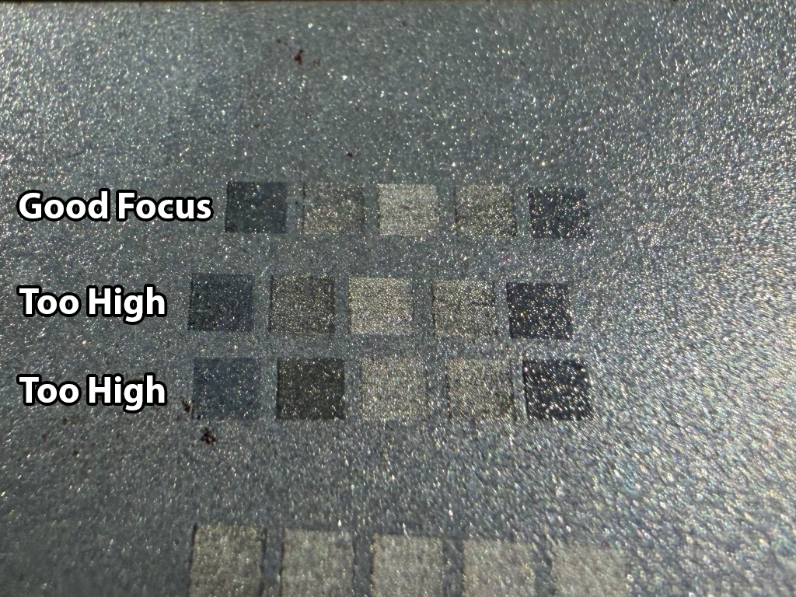

# EZCAD3 Five-Box Focus Calibration Procedure

After finding the approximate focal height with the [Ramp Card Focus Calibration Procedure](ramp_card_method.md), I use a five-box test to fine-tune it. EZCAD3 lets me give each marking layer a different Z-index offset, so I can compare five focus positions in a single test.

## The idea: Make both sides match

**The goal is to find the focus setting where the laser's marking response is balanced on either side of the center.**

I mark five squares in a row. The middle square uses my current focus setting. Two squares test positions on one side of that setting, and two test positions on the other side.

I am looking for a pattern like this:

```text
Square:       1     2     3     4     5
Appearance:   A     B     C     B     A

Matching pairs: 1 & 5, and 2 & 4
```

In other words, **Square 1 should look like Square 5, and Square 2 should look like Square 4**. Square 3 is the center of the progression. A, B, and C mean different *appearances*, not specific shades or colors. The center does not have to be the darkest square.

Here is what this looks like on steel:



The top row shows the balanced result I want. In the lower rows, the uneven pattern is consistent with an off-center focus setting. **The important thing is the matching pairs, not the precise color of the marks.**

## Before you start

- **Level the galvo first.** Complete [Section 1.4: Precision Galvo Leveling](setup_calibration.md#14-precision-galvo-leveling). The lens must be square to the bed, and the test steel must be flat and parallel to it. Otherwise, a left-to-right height difference can look like a focus problem.
- **Run the ramp card test first.** This gets you close enough for the smaller five-box adjustments to be useful.
- **Use a flat piece of scrap steel.** Measure and record its thickness. Set the EZCAD3 **material offset** to that measured thickness so the test starts with the height of the steel above the bed accounted for.

## Set up the five squares in EZCAD3

Create five equal squares in a horizontal row, with a small gap between them. Put **each square on its own layer**. Use identical marking settings on all five layers, changing only their **Z-index offsets**.

The center square always uses **Z = 0**. For Squares 1 through 5, the pattern of layer offsets is:

```text
-2N    -N     0     +N    +2N
```

**N** is simply the spacing between neighboring test heights. Here are the actual values I use, listed from Square 1 to Square 5:

- **Start, N = 1 mm:** -2, -1, 0, +1, +2 mm
- **Refine, N = 0.5 mm:** -1, -0.5, 0, +0.5, +1 mm
- **Fine, N = 0.25 mm:** -0.5, -0.25, 0, +0.25, +0.5 mm

### Two offsets, two different jobs

- **Layer Z-index** spreads the five test positions apart. It tells EZCAD3 how far each square should be from the center position.
- **Material offset** moves the *entire five-box test* together. This is what I change between test runs to find the center.

**Do not adjust the saved base focus during the test.** That comes at the end.

## Run the test

1. **Mark the five squares.** On my 100 W MOPA fiber laser, I use low power, usually **under 10%**, on steel. The marks need to change visibly as focus changes. Keep speed, frequency, pulse duration, and hatch settings the same for every square.
2. **Compare the matching pairs.** Look at Squares **1 and 5**, then **2 and 4**. Are the two sides reasonably symmetrical around Square 3?
3. **If not, change the material offset** by a small amount and mark the five squares again on a clean area of the same level steel. Repeat until the pattern is balanced. Leave the layer Z-index values alone during this stage.
4. **Narrow the test.** Change N from **1 mm to 0.5 mm** and repeat. If the marks still show useful differences, try **0.25 mm** for a final adjustment.
5. **Stop when the pairs match as closely as you can reliably judge.** Smaller increments are not automatically better if the marks become indistinguishable.

### If the result is hard to read

- **One side consistently looks different:** Adjust the material offset and repeat. If the imbalance persists, recheck galvo leveling and whether the steel is flat.
- **All five squares look the same:** You do not yet have a useful focus test. Adjust the common marking settings so differences in focus are visible, or use a wider Z-index increment.
- **Marks are too faint:** Increase visibility by adjusting the common marking settings, not by changing individual squares.

## Save the final focus position

Once the pattern is balanced at the smallest useful increment, record the final material offset and update the lens's **stored base focus** in EZCAD3.

**Remember that the material offset started at the thickness of the steel.** The final material-offset value includes both that thickness allowance and the small correction discovered during testing.

For example, if the steel is **1.5 mm thick** and the final material offset is **1.8 mm**, the adjustment found during testing is **0.3 mm**, not 1.8 mm. Translate that adjustment into the stored base focus using your machine's Z-axis direction and reference plane. Do not count the steel thickness twice.

After saving the corrected base focus, return the temporary material offset to its normal value and verify the result as needed. Record the lens used, steel thickness, final material offset, stored base focus, and smallest useful N value.

**Repeat this calibration for each lens.** Each lens has its own focal distance.
