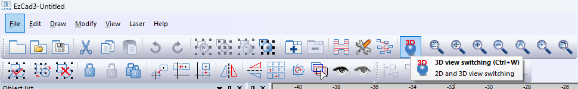
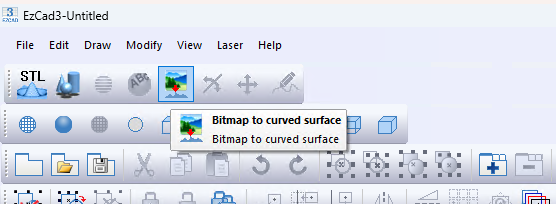
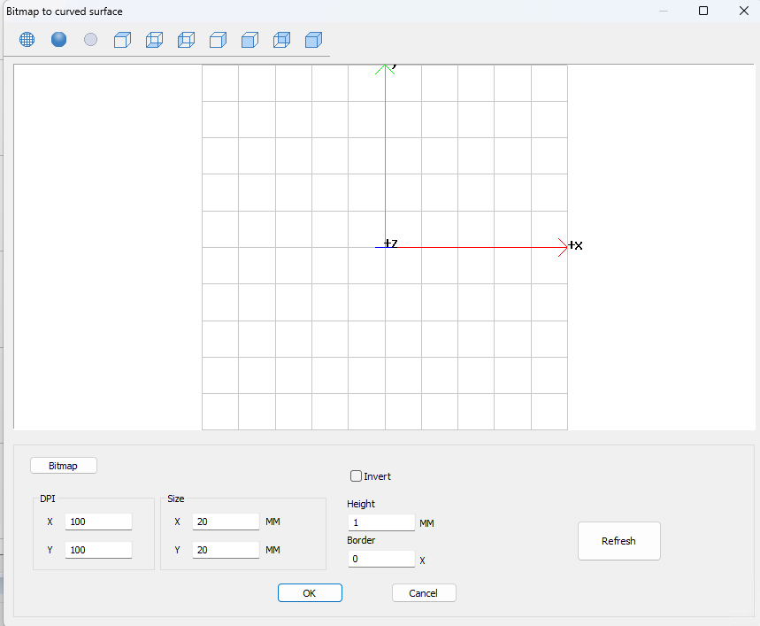
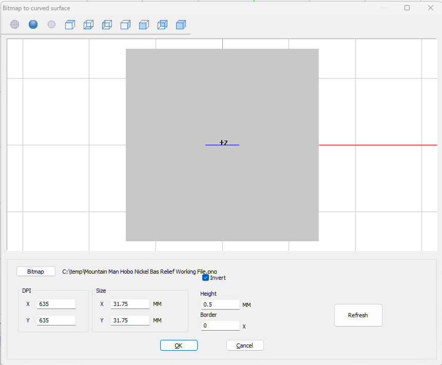
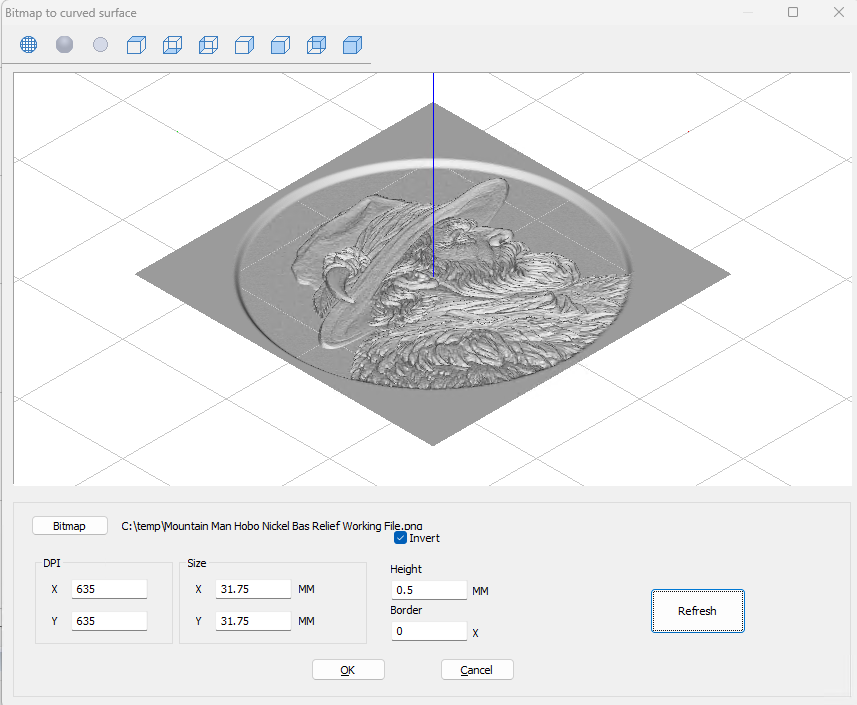
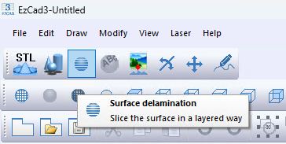
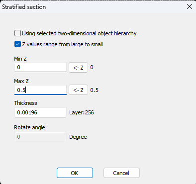
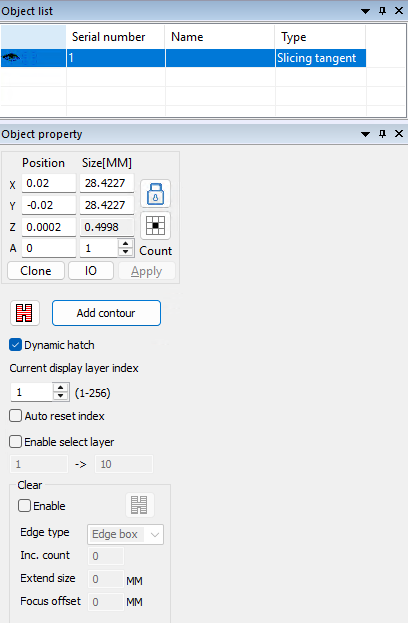
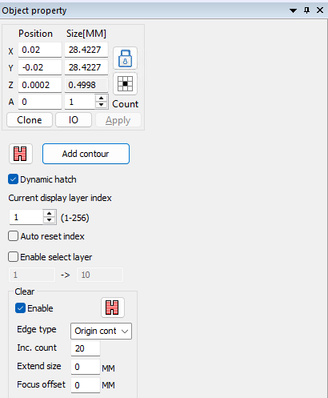

# Engraving a Grayscale Depthmap in EZCAD3

This guide documents **my own workflow** for converting a grayscale depthmap into a sliced 3D engraving in EZCAD3. It reflects what I have tested and observed on my equipment. **It is not an authoritative or comprehensive guide to EZCAD3.** Other methods may work just as well, and some software behaviors described here may differ by version.

The goal is to explain the steps needed to prepare an existing depthmap, convert it into a 3D surface, and slice that surface for engraving.

**Who this is for:** Fiber laser users who are already comfortable with basic EZCAD3 operations and have some experience importing and slicing STL models for 2.5D engraving.

**What this guide does not cover:** Creating a depthmap from scratch, choosing laser pen parameters, configuring individual hatch settings, or calibrating the laser's material-removal rate.

The procedure has two parts:

1. [Prepare an existing depthmap for EZCAD3](#part-1-prepare-the-depthmap)
2. [Convert and slice the depthmap in EZCAD3](#part-2-convert-and-slice-the-depthmap-in-ezcad3)

**Optional reading:** The [Technical Appendix](#technical-appendix-optional-reading) explains the reasoning and testing behind the resolution and slicing choices. **You do not need to read the appendix to follow the procedure.**

---

## Part 1: Prepare the Depthmap

### 1. Finish and save the working artwork

Start with a completed grayscale depthmap from whatever source you prefer. Adjust its grayscale levels, proportions, and positioning until it represents the relief you want to engrave.

**Save your finished working file before preparing an EZCAD3 export.** Your working artwork and your final export do not have to be the same resolution.

For example, I edited my working depthmap at **1208 × 1208 pixels**, then exported a smaller copy for EZCAD3. Working at a higher resolution is not required; it was simply the starting point for my artwork.

### 2. Choose the intended size and export resolution

Decide how large the engraving will be and what DPI you intend to use in EZCAD3. Use those two values to calculate your target bitmap dimensions:

```text
Pixels per axis = (physical size in mm / 25.4) × DPI
```

For my example, I am preparing a **31.75 mm (1.25 inch)** square bitmap for a coin design. I commonly use a **0.04 mm hatch line spacing**, equivalent to 25 hatch lines per millimeter, or **635 lines per inch**. I use **635 DPI** as a practical *starting point* for the EZCAD3 model's XY sampling resolution.

```text
31.75 mm / 25.4 × 635 DPI = 793.75 pixels
Round to 794 pixels
```

That produces a target export of **794 × 794 pixels**.

> **Why not just use the highest possible resolution?** More input pixels do not automatically produce a better engraving. The correct sampling density depends on the artwork and the laser process. My 635 DPI choice is a practical starting point, **not** a verified optical resolution limit or an EZCAD3 requirement. See the [appendix](#a-bitmap-resolution-hatch-spacing-and-mesh-complexity) for the test results.

### 3. Resize a copy and export it

Use the image editor of your choice to:

1. Resize a **copy** of the finished depthmap to the target pixel dimensions, using your preferred resampling method.
2. Check that the proportions, grayscale transitions, and important relief details still look correct.
3. Export the image as **TIFF, PNG, or BMP**, all of which are supported by EZCAD3.

I prefer to perform the resizing in my image editor because it offers choices for resampling. EZCAD3 does not expose comparable resampling controls in its **Bitmap to curved surface** dialog.

The finished bitmap is now ready for EZCAD3. **Keep the original working artwork separately** in case you need to create a different export later.

---

## Part 2: Convert and Slice the Depthmap in EZCAD3

The screenshots below were captured from my EZCAD3 installation. The **31.75 mm / 635 DPI / 0.5 mm** values are an example, not required settings for other artwork.

### 4. Switch to 3D View

Switch from the normal EZCAD3 workspace to **3D View** using either method:

- Press **Ctrl + W**.
- Click the **3D View** toolbar button, represented by a globe with a red and blue **3D** symbol. Hovering over the button displays its name.



*Figure 1. The 3D View button in EZCAD3's main toolbar.*

### 5. Open Bitmap to curved surface

In 3D View, click the **Bitmap to curved surface** button on the 3D toolbar. Hovering over the button displays its name.



*Figure 2. The Bitmap to curved surface command.*

### 6. Load the bitmap and configure the 3D model

The **Bitmap to curved surface** dialog opens. Click **Bitmap** and select the image you exported in Part 1.



*Figure 3. The Bitmap to curved surface dialog before loading an image.*

Set the controls for your artwork. My example uses:

| Setting | Example value | What it does in this workflow |
| --- | --- | --- |
| **Bitmap** | Exported grayscale depthmap | Selects the source image. |
| **Invert** | **Checked** | Interprets white as the **highest** surface and black as the **lowest**. Without Invert, I have observed the opposite interpretation. |
| **DPI X / DPI Y** | **635 / 635** | Sets the sampling density used when EZCAD3 generates the 3D surface. |
| **Size X / Size Y** | **31.75 / 31.75 mm** | Sets the intended X/Y dimensions of the generated model. |
| **Height** | **0.5 mm** | Sets the intended Z height of the generated model. |
| **Border** | **0** | Left at zero; I have not investigated this control. |

**Important:** After selecting the image and setting the values, click **Refresh**. In my experience, clicking **OK** without first clicking Refresh does **not** create the 3D object.

### 7. Inspect the generated surface

After clicking **Refresh**, inspect the preview. The default view is **wireframe mode**, viewed from **above**. From this angle, the model can appear nearly flat, even when the relief has been generated.



*Figure 4. Default wireframe top view. The model's relief is difficult to evaluate.*

For a clearer preview, click:

1. **Display render mode:** The **solid globe**, second button from the left in the dialog's preview toolbar.
2. **Isometric view:** The **far-right** view button in that toolbar.

In this dialog, the **currently selected view or display button appears gray**; inactive choices appear blue. These preview buttons do not show the same helpful tooltips found in the main 3D workspace.



*Figure 5. The same depthmap in rendered isometric view, making the relief easier to inspect.*

These are viewing controls, not additional steps in generating the geometry. When the model looks correct, click **OK** to return to the main EZCAD3 3D workspace.

**From this point forward, the workflow is the same as working with an imported STL model.**

### 8. Open the slicing dialog

In the main 3D workspace, click **Surface delamination** on the toolbar. Its tooltip reads *Slice the surface in a layered way*.



*Figure 6. Surface delamination opens the slicing controls.*

This opens the **Stratified section** dialog.

### 9. Choose the Z range and slice thickness



*Figure 7. The 0.5 mm model configured to produce 256 layers.*

The settings I use are:

- **Using selected two-dimensional object hierarchy:** Leave unchecked for this workflow.
- **Z values range from large to small:** Leave checked for this workflow.
- **Min Z / Max Z:** Use the full Z range of the model. Each **← Z** button copies the model boundary value shown to its right into the field. For the example model, that is **0** to **0.5 mm**.
- **Thickness:** Enter the desired slicing interval in millimeters. EZCAD3 displays the resulting **Layer** count.
- **Rotate angle:** Not adjusted in this workflow.

**Choose Thickness based on your known material removal per layer.** The usual approach is to calibrate the laser's pen and hatch settings, measure how much material the complete engraving operation removes per layer, and use that result to guide slice thickness. The slice thickness itself does **not** control how much material the laser removes.

For illustration, dividing a **0.5 mm** model using a thickness of approximately **0.00196 mm** produces **256 layers** in EZCAD3. This is the example shown in Figure 7, not a required layer count.

An 8-bit depthmap can contain **256 grayscale values**. If the artwork uses those levels, slicing into substantially fewer than 256 layers may lose some vertical detail; using more than 256 layers may create redundant or nearly identical slices without adding information to the source image. This is a **consideration**, not a rule to override your measured removal rate. The [optional appendix](#c-grayscale-levels-slice-count-and-actual-engraving-depth) explains the limitations of this comparison.

Click **OK** to generate the sliced object.

### 10. Review the resulting Slicing tangent object

EZCAD3 creates a new entry in the **Object list**, with type **Slicing tangent**. Select it to review the **Object property** panel.



*Figure 8. The resulting Slicing tangent object and its properties.*

Check the dimensions and layer count rather than assuming they will exactly match the original image canvas. In my example, a **31.75 mm** imported bitmap yields an approximately **28.4227 mm square** sliced object because the artwork occupies a smaller area within the surrounding light rim. The exact result depends on the artwork and the generated geometry.

### 11. Account for hatch settings and optional cleaning

The **main Hatch button**, above **Dynamic hatch**, opens the hatch settings for the sliced object. **Those settings apply to every layer.** If you enable cross-hatching or increase the hatch count, those operations run on *each* layer. Account for the entire hatch configuration when calibrating how much material is removed per layer.

The optional **Clear** section can run a separate operation at a specified layer interval. I use it, when needed, for a periodic **cleaning pass**:

- Enable **Clear** and configure its separate pen/hatch settings with the Hatch button in that section.
- Set **Inc. count** to the interval. For example, **20** runs the Clear operation every 20 layers.
- In my workflow, I use **Original contour** as **Edge type**. I have not tested the differences among the available edge-type choices.
- **Click Apply** at the top of the Object property panel after changing Clear settings. EZCAD3 can lose unapplied changes when other settings are modified.



*Figure 9. Optional Clear settings for a cleaning operation every 20 layers.*

Configuring pen and hatch parameters is outside this guide. The important point is that **both the main hatch and any periodic Clear operation can affect the actual engraving depth**.

**The depthmap has now been converted and sliced.** The object can be handled using your normal EZCAD3 3D engraving setup and calibration process.

---

## Technical Appendix (Optional Reading)

**This appendix is explanatory, not procedural. You can skip it entirely and still complete both parts of the workflow.** It records the reasoning behind my resolution choices, tests of EZCAD3's behavior, and limitations of what those tests establish.

### A. Bitmap resolution, hatch spacing, and mesh complexity

#### Why I start around 635 DPI

My typical hatch line spacing for this type of work is **0.04 mm**:

```text
1 / 0.04 mm = 25 hatch lines per mm
25 × 25.4 = 635 hatch lines per inch
```

That gives me a convenient starting point of **635 DPI** for preparing a bitmap and generating a mesh. At **31.75 mm (1.25 inches)**, this corresponds to approximately **794 pixels per axis**.

However, **hatch spacing and bitmap resolution are not the same thing**. Hatch spacing describes the distance between adjacent engraving lines. A bitmap samples an image in two dimensions. Additional image resolution might help preserve contour placement or features between hatch lines, but may also create unnecessary processing. I have not established an optimal DPI for every design.

I have estimated the laser spot size with my 110 mm lens at roughly **0.038 mm**, but I do **not** have reliable documentation or measurements confirming that figure. It should not be treated as the laser's verified resolution.

#### Four controlled EZCAD3 tests

To explore how **Bitmap to curved surface** generates geometry, I used the same image at two export sizes. Each test used **31.75 × 31.75 mm** model size, **0.5 mm** height, and **Invert** enabled.

| Test | Source bitmap | EZCAD3 DPI X/Y | Vertices | Faces |
| --- | --- | ---: | ---: | ---: |
| A | 794 × 794 | 635 | 632,021 | 1,260,864 |
| B | 1110 × 1110 | 888 | 1,234,317 | 2,464,192 |
| C | 794 × 794 | 888 | 1,236,540 | 2,468,634 |
| D | 1110 × 1110 | 635 | 632,021 | 1,260,864 |

The reported model bounds did not change across these tests:

- X: **-15.875 to 15.875 mm**
- Y: **-15.875 to 15.875 mm**
- Z: **0 to 0.5 mm**

**What the tests establish:**

- The **same DPI** produced the same or almost the same number of mesh vertices and faces, even when the source bitmap dimensions differed substantially.
- Increasing the EZCAD3 DPI from **635** to **888**, while keeping the physical dimensions fixed, **nearly doubled** the face count. This even happened when the bitmap itself was unchanged (Tests A and C).
- Thus, **EZCAD3's entered DPI and model size strongly affect generated mesh complexity**. The source bitmap's dimensions alone do not determine the final polygon count.

The results are consistent with EZCAD3 sampling or resampling the image to create a mesh at its target DPI and physical size. We have **not** established which interpolation algorithm it uses, or whether matching the bitmap dimensions and DPI actually improves performance or engraving quality. My preference to resize in an image editor is about retaining control over the resampling method.

#### An interesting pattern in the mesh counts

For these square-image tests, the reported counts fit:

```text
Vertices = (N + 1)^2 - 4
Faces    = 2 × N^2 - 8
```

Here, **N** appears to be an internal sample count across one axis, not necessarily the source image's pixel width. For example:

- At **635 DPI**, the counts fit **N = 794**.
- With an **1110 × 1110** image at **888 DPI**, they fit **N = 1110**.
- With a **794 × 794** image at **888 DPI**, they fit **N = 1111**.

That one-sample difference suggests some rounding or resampling detail we have not isolated. These formulas **describe the observed tests**; they are not a verified specification of EZCAD3's internal geometry algorithm.

### B. DPI in EZCAD3 versus bitmap dimensions

For a planned engraving size, use the following relationship as a guide when choosing the export dimensions:

```text
Target pixels = physical size in mm / 25.4 × DPI
```

DPI and **Size X/Y** are entered separately in EZCAD3. Based on my tests, both participate in determining the generated surface's sampling density and physical extent. The bitmap's stored DPI metadata is not a substitute for verifying its actual pixel dimensions and entering the intended values in the dialog.

I prefer to export a bitmap near the target size because the image editor provides explicit resampling choices. This is a **workflow preference**, not proof that EZCAD3 will fail with larger images or that additional pixels are never useful.

### C. Grayscale levels, slice count, and actual engraving depth

**Normally, measured material removal drives slice thickness.** As with STL engraving, I use the known removal rate for my pen and hatch configuration to select an appropriate slicing thickness. That rate should reflect the *complete operation on each layer*, including cross-hatching, hatch count, and any periodic Clear operations. Slice thickness specifies how EZCAD3 divides the model; it does **not** make the laser remove that amount of material.

A grayscale depthmap adds a separate consideration: **how many distinct elevations the source image can represent**. An **8-bit grayscale** image has 256 possible intensity values (0 through 255). If the artwork actually uses most or all of those values, the chosen slice count may affect how much of that vertical detail survives the slicing process.

- **Underslicing (fewer than 256 layers):** Multiple grayscale elevations may be represented by the same or similar engraving layers. Fine changes in relief height can be lost, making transitions less smooth.
- **Overslicing (more than 256 layers):** Additional layers cannot create new grayscale values in the source image. They may repeat or closely resemble adjacent slice contours, particularly in reliefs with discrete, terrace-like elevations, adding engraving time without a corresponding increase in useful detail.

**Neither result is guaranteed.** EZCAD3 creates a 3D surface from the image, and interpolation between grayscale samples can produce intermediate heights. As a result, more than 256 slices can still have distinct contours, even from an 8-bit source. Likewise, some artwork uses far fewer than 256 grayscale levels. **256 is a useful reference point, not an EZCAD3 limit or a required layer count.**

For perspective, dividing a **0.5 mm** model into 256 slices gives:

```text
0.5 mm / 256 slices = 0.001953125 mm per slice
```

That is about **1.95 micrometers per slice**. Strictly speaking, the 256 values in an 8-bit depthmap define 255 intervals between the darkest and brightest endpoints. The calculation above describes the slice spacing for 256 slices, not a proven one-to-one mapping between grayscale values and EZCAD3 layers.

There are also limits to what I have verified:

- I have **not confirmed** whether EZCAD3 supports greater than 8-bit precision when converting depthmaps.
- I have **not established** how EZCAD3 interpolates between source pixels during surface generation.
- Creating 256 slices does **not** guarantee 256 distinct engraved depths in the finished material.

The practical approach remains to **let calibrated material removal guide slicing**, while recognizing that a depthmap's tonal precision may justify evaluating whether the resulting layer count adequately represents the desired relief.

### D. What Min Z, Max Z, and Thickness control

**Min Z** and **Max Z** select the vertical range that EZCAD3 will slice. The **← Z** buttons fill these fields from the model's actual lower and upper bounds.

For a full-height model, an approximate layer-count relationship is:

```text
Layers = round up [(Max Z - Min Z) / Thickness]
```

Two verified examples using **0.0026 mm** slice thickness:

| Z range | Range height | EZCAD3 layers |
| --- | ---: | ---: |
| 0 to 0.5 mm | 0.5 mm | **193** |
| 0.25 to 0.5 mm | 0.25 mm | **97** |

The second test confirmed that setting **Min Z to 0.25 mm** sliced only the upper half of the 0.5 mm model. I did not investigate whether partial-range slicing preserves the original absolute Z coordinates in subsequent operations.

### E. Controls not investigated in this workflow

I have not characterized the function of **Border** in the bitmap conversion dialog, **Rotate angle** in Stratified section, the **Using selected two-dimensional object hierarchy** checkbox, or the differences among the **Clear Edge type** options (**Edge box**, **Original contour**, and **Convex Hull contour**). They are mentioned only where needed to document the settings I use, rather than to imply a verified understanding of their behavior.

---

*Documented from hands-on EZCAD3 testing for Angry Thumb Studio. Adjust all dimensions and engraving parameters for your own machine, lens, material, and artwork.*
